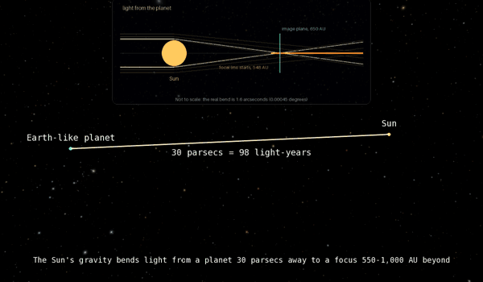

# The Sun as a Telescope: the Solar Gravitational Lens in OpenSpace



The Sun bends light from a distant planet into a focus that starts 548 AU away. A telescope there sees the planet as an Einstein ring hugging the solar limb. This project puts that mission in [OpenSpace](https://www.openspaceproject.com):
- the focal line
- the 1,340 m image of an Earth-like planet 30 pc away
- a twelve-spacecraft formation sweeping it
- a live view through one spacecraft's telescope, drawn by a custom C++/GLSL module

It grew out of my senior thesis on autonomy for this mission. Every physical number on screen is checked against published optics or against a second, independent method.

**Clips:** [flat, 21 s](media/sgl_telescope_flat.mp4) · [dome master (fisheye), 22 s](media/sgl_telescope_dome.mp4)

## What's on screen

- **The image plane:** a soft glow, 1.5 planet-diameters wide. It's what the telescopes actually record. The Sun's lens has strong spherical aberration, so each spot gets light from the whole planet. The directly imaged spot carries only 0.4% of it.
- **The Sun and the focal line:** the camera looks back toward the Sun from just behind the image plane. The focal line runs from the planet's image to the Sun, 650 AU away. The Sun's disk is 1.5″ across from there, so a marker sits on the line of sight to show where it is. The thin streak through it is the planets' orbits seen almost edge-on.
- **The formation:** twelve spacecraft fly a rigid line 120 m apart, sampling the image on bang-coast-bang transfers. The sweep takes 13.4 days, against 115 for a single spacecraft.
- **Sample points:** colored by the brightness recorded at each stop.
- **The eyepiece:** spacecraft 6's telescope looking back at the Sun. Inside the planet's image it sees a full Einstein ring at 1.61″; outside, two arcs. Press **M** to step the planet's magnification (×22,600 / ×56,600 / ×135,700). The real planet is about a millionth of an arcsecond across, so it has to be enlarged to be seen at all, and the label says by how much.

## How it's built

| Layer | What | Where |
|---|---|---|
| A · physics data | Python. Puts the real DSCOVR EPIC Earth at 30 pc and blurs it with the aperture-averaged SGL PSF from Toth & Turyshev (2021). Outputs textures, measurements, recoveries and trajectory CSVs. | [`layer_a/`](layer_a) |
| B · mission scene | Lua assets generated from layer A: focal line, image plane, formation, samples | [`openspace/build_asset.py`](openspace/build_asset.py), [`openspace/sgl/`](openspace/sgl) |
| C · telescope view | `Sgl` OpenSpace module. `ScreenSpaceSglTelescope` inverts the lens equation per pixel on the GPU and follows a spacecraft node. | [`openspace/module_sgl/`](openspace/module_sgl) |
| Prototype | The same telescope math in numpy, used as the reference for the GPU | [`layer_c_proto/`](layer_c_proto) |
| Thesis rerun | The thesis FBPINN reconstruction under the corrected physics (Colab) | [`colab/`](colab) |

## How it's checked

| Check | Result |
|---|---|
| PSF limits: μ(0), μ(d/2), μ → d/4ρ | Exact |
| Deconvolution penalty, simulated vs paper | 0.83/√N vs 0.878/√N (same scaling, 6% apart) |
| Ring radius vs θ<sub>E</sub> at 650 AU | 1.6076″ vs 1.6076″ |
| Ray-traced ring light vs wave-optics image plane (81 positions) | r = 1.0000, ratio spread 0.2%. Flipped orientations fit 20–30× worse. |
| GPU frame vs Python reference | r = 0.9992, mean difference 1.2/255 on the ring |
| Scene geometry in OpenSpace | Image plane 650.0000 AU from the Sun, on the intended axis |

## Notes

- **Magnification:** the planet in the eyepiece is magnified, and the label shows the factor. Total ring light grows with the magnification, so any brightness readout divides it back out.
- **Spacecraft paths:** these are analytical bang-coast-bang reference paths, the profile the thesis controllers were trained to imitate. They are not outputs of the trained networks.
- **Corona:** drawn stylized. The real corona outshines the ring by orders of magnitude.
- **Colors:** EPIC's 680, 551 and 443 nm bands, scaled for display, not calibrated reflectance.
- **Thesis corrections:**
  - A review of my thesis found that its PSF put 161× too much light in the directly imaged spot. This project uses the published PSF instead.
  - Rerun under the corrected physics, the thesis FBPINN loses to classical Tikhonov deconvolution, though it still beats a standard PINN. The numbers are in [`colab/`](colab).

## Run it

Requires Windows, Visual Studio 2026 (MSVC 19.50), CMake 4.0 or newer, OpenSpace v0.22.0 source, and Python 3.11 or newer.

1. **Python environment:**
   ```bash
   python -m venv .venv
   .venv/Scripts/python -m pip install -r requirements.txt
   ```
2. **Layer A data:**
   ```bash
   cd layer_a
   ../.venv/Scripts/python make_textures.py
   ../.venv/Scripts/python make_trajectories.py
   ```
3. **Scene assets:**
   ```bash
   cd openspace
   ../.venv/Scripts/python build_asset.py
   ```
4. **Module:** run `../.venv/Scripts/python install_module.py`, then configure OpenSpace with `-DOPENSPACE_MODULE_SGL=ON` and build.
5. **Launch:**
   ```bash
   bin/RelWithDebInfo/OpenSpace.exe --profile sgl_telescope --bypassLauncher
   ```
6. **Reel:** with OpenSpace running, use `openspace/tools/record_reel.py [--dome]`, then `export_frames.py <recording> 30`, then `encode_clip.py out.mp4`.

The scripts assume my local paths in a few places (`OPENSPACE_ASSETS` in `build_asset.py`, `DST` in `install_module.py`, the recordings folder). Change them for your machine.

## Layout

```
layer_a/          physics model, textures, trajectories (Python)
layer_c_proto/    telescope-view prototype, validation, option renders (Python)
openspace/
  build_asset.py  generates the Lua assets and profiles
  sgl/            generated assets, textures, data
  module_sgl/     the Sgl C++ module and shaders
  tools/          Lua-over-TCP control, recording, frame export, encoding
colab/            FBPINN rerun notebook and results
media/            clips and preview
```

## References

- V. T. Toth and S. G. Turyshev, *Image recovery with the solar gravitational lens*, Phys. Rev. D 103, 124038 (2021), [arXiv:2012.05477](https://arxiv.org/abs/2012.05477)
- S. G. Turyshev and V. T. Toth, *Image formation for extended sources with the solar gravitational lens*, Phys. Rev. D 102, 024038 (2020)
- OpenSpace, AMNH, Linköping University, NYU and University of Utah SCI, [openspaceproject.com](https://www.openspaceproject.com)
- DSCOVR EPIC Level 1B, 13 June 2015, NASA, via `earthaccess`

*Andrew Simon · Princeton MAE '26 · Code under the [MIT License](LICENSE). DSCOVR EPIC imagery courtesy of NASA.*
