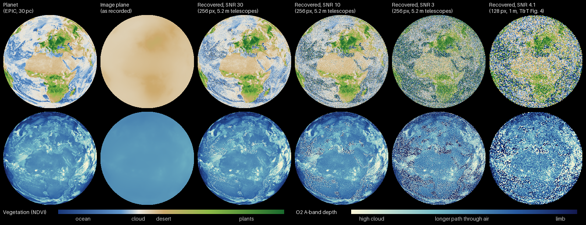

# The Sun as a Telescope: the Solar Gravitational Lens in OpenSpace


The Sun bends light from a distant planet into a focus that starts 548 AU away. A telescope there sees the planet as an Einstein ring hugging the solar limb. This project puts that mission in [OpenSpace](https://www.openspaceproject.com):
- the focal line
- the 1,340 m image of an Earth-like planet 30 pc away
- a twelve-spacecraft formation sweeping it
- a live view through one spacecraft's telescope, drawn by a custom C++/GLSL module

It grew out of my senior thesis on autonomy for this mission. Every physical number on screen is checked against published optics or against a second, independent method.

**Clips:** [flat with the opening, 1080p, 66 s](media/sgl_telescope_flat.mp4) · [dome master with the opening (fisheye, 1024 px), 67 s](media/sgl_telescope_dome.mp4). These are MP4 downloads (28 MB and 10 MB); GitHub doesn't play files this size in the browser.

https://github.com/user-attachments/assets/72c2ba42-3f73-4081-9ab4-b2c5bf416960


https://github.com/user-attachments/assets/a2536ab4-b207-4119-b1a9-75caaa157798


**Where to look:**
- [`screenspacesgltelescope.cpp`](openspace/module_sgl/rendering/screenspacesgltelescope.cpp) and [`telescope_fs.glsl`](openspace/module_sgl/shaders/telescope_fs.glsl): the OpenSpace module that ray-traces the Einstein ring on the GPU
- [`build_asset.py`](openspace/build_asset.py): turns the data into the Lua assets and profiles
- [`make_intro.py`](openspace/tools/make_intro.py): writes the opening's session recording, one camera keyframe per frame
- [`sgl_psf.py`](layer_a/sgl_psf.py): the lens's point-spread function, from Toth & Turyshev (2021)
- [`compare_gpu_frame.py`](openspace/tools/compare_gpu_frame.py) and [`layer_c_proto/`](layer_c_proto): the GPU view checked against an independent NumPy version
- [`openspace/README.md`](openspace/README.md): the scene node by node, and what I learned about OpenSpace 0.22 building it

## The opening

Both clips start by following the planet's light all the way to the image (about 45 s):
1. **Overview:** the planet and the Sun, 30 parsecs apart. A box around the Sun opens into a side diagram of how it bends light.
2. **The planet:** a flight out to an Earth twin 98 light-years away, a globe whose day side is the real Earth from DSCOVR EPIC. Its phase changes as the camera swings round it.
3. **The trip:** a pulse of light leaves the planet and the camera rides with it. The time-lapse is logarithmic, so the distance shrinks by a steady factor each second, and a clock runs from February 1977 to December 2074.
4. **The bend:** the pulse skims 0.09 solar radii above the Sun's surface, shown at a third of the speed of light.
5. **Convergence:** rays from around the whole limb narrow into a cone 1.5 million km wide and meet 650 AU out, 3.75 days later.
6. **The image:** the camera swings round to the reel's view of the image plane. On the dome, that view looks across the focal axis: the image plane on the left of the circle, the Sun 650 AU away on the right.

The rays are true geometry. They pass the Sun at the Einstein radius for 650 AU (1.09 solar radii) and meet on the axis there. The bend itself is 1.6″, too small to see, so only the overview diagram exaggerates it, and it says so. [`openspace/tools/make_intro.py`](openspace/tools/make_intro.py) writes every frame of the camera path, so playback is exact.

## What's on screen

- **The image plane:** a soft glow, 1.5 planet-diameters wide. It's what the telescopes actually record. The Sun's lens has strong spherical aberration, so each spot gets light from the whole planet. The directly imaged spot carries only 0.4% of it.
- **The Sun and the focal line:** the camera looks back toward the Sun from just behind the image plane. The focal line runs from the planet's image to the Sun, 650 AU away. The Sun's disk is about 3″ across from there, so a marker sits on the line of sight to show where it is. The thin streak through it is the planets' orbits seen almost edge-on.
- **The formation:** twelve spacecraft fly a rigid line 120 m apart, sampling the image on bang-coast-bang transfers. The sweep takes 13.4 days, against 115 for a single spacecraft.
- **Sample points:** each in the color recorded at its stop.
- **The eyepiece:** spacecraft 6's telescope looking back at the Sun. Inside the planet's image it sees a full Einstein ring at 1.61″; outside, two arcs. Press **M** to step the planet's magnification (×22,600 / ×56,600 / ×135,700). The real planet is about three millionths of an arcsecond across, so it has to be enlarged to be seen at all, and the label says by how much.
- **Biosignatures:** press **N** to step through vegetation and oxygen maps on the planet's disk: the planet itself, what the telescopes record, and recoveries. The eyepiece switches to the same false color.

## Biosignatures



Would the lens show that the planet is alive? [`layer_a/make_biosignatures.py`](layer_a/make_biosignatures.py) runs two classic biosignatures through the same blur and recovery, from EPIC's calibrated 680, 764 and 780 nm bands:
- **Vegetation (NDVI):** plants absorb red light and reflect near-infrared, so (R780 − R680)/(R780 + R680) is high over forest and low over desert, ocean and cloud.
- **Oxygen (the A-band):** 764 nm sits in an oxygen absorption band, so 1 − R764/R780 measures how much air the light crossed.

The recovery filter is set from the noise level alone (the discrepancy principle), not tuned against the true planet. Scores compare NDVI from the recovered bands with NDVI from the true ones:

| Case | Pixel NDVI, r | 400 km blocks, r | Vegetated blocks found |
|---|---|---|---|
| SNR 30 per band, 256² | 0.93 | 1.00 | 43 of 43 |
| SNR 10 | 0.68 | 1.00 | 43 of 43 |
| SNR 3 | 0.38 | 0.99 | 42 of 43 |
| 1 m telescopes, 128², SNR 4.1 (Toth & Turyshev's Fig. 4 regime) | 0.43 | 0.92 | 36 of 43 |

- **Pixel by pixel, NDVI is noisy below SNR 10.** It's a ratio of two noisy bands.
- **At continent scale it survives every case.** Over 400 km blocks, the forests of central Africa and Europe stand apart from the Sahara, with at most one false alarm in 689 blocks.
- **Imaging is what reveals the vegetation.** Seen as a single point, the whole planet's NDVI is 0.08, about the Sahara's (0.075). Resolved, the Congo basin reads 0.21 and Europe 0.24, recovered to within 0.004 at 256² and 0.012 with 1 m telescopes.
- **Oxygen needs no imaging.** The band shows in the summed light of the disk: depth 0.630 against 0.633 true, with noise below 0.0002. The small offset comes from the blur, which keeps more of the center's light inside the disk than the limb's, where the band is deepest. The map adds cloud heights on top (block r = 0.91 to 1.00).

Limits:
- **The noise is idealized:** Gaussian, at a set SNR per band. The real noise comes from the corona, and the narrow filter the A-band needs collects far fewer photons than broad red and near-infrared filters, so the oxygen map would take longest.
- **The planet holds still.** A real sweep takes months while the planet turns and its clouds change. Like Toth & Turyshev's simulations, this treats the image as static, which is a major open problem for SGL imaging.
- **Oxygen alone isn't proof of life.** Some lifeless planets can build up oxygen too. A vegetation signal that lines up with continents is the kind of context that strengthens the case.

## How it's built

| Layer | What | Where |
|---|---|---|
| A · physics data | Python. Puts the real DSCOVR EPIC Earth at 30 pc and blurs it with the aperture-averaged SGL PSF from Toth & Turyshev (2021). Outputs textures, measurements, recoveries, biosignature maps and trajectory CSVs. | [`layer_a/`](layer_a) |
| B · mission scene | Lua assets generated from layer A: focal line, image plane, formation, samples, biosignature maps, and the opening's planet, rays and captions | [`openspace/build_asset.py`](openspace/build_asset.py), [`openspace/sgl/`](openspace/sgl) |
| C · telescope view | `Sgl` OpenSpace module. `ScreenSpaceSglTelescope` ray-traces each pixel through the lens equation on the GPU and follows a spacecraft node. | [`openspace/module_sgl/`](openspace/module_sgl) |
| Prototype | The same telescope math in NumPy, used as the reference for the GPU | [`layer_c_proto/`](layer_c_proto) |
| Reconstruction rerun | My thesis's reconstruction network (a finite-basis physics-informed neural network, FBPINN) rerun under the physical blur and compared with classical methods (Colab) | [`colab/`](colab) |

## How it's checked

| Check | Result |
|---|---|
| PSF limits: μ(0), μ(d/2), μ → d/4ρ | Exact |
| Deconvolution penalty, simulated vs paper | 0.83/√N vs 0.878/√N (same scaling, 6% apart) |
| Ring radius vs θ<sub>E</sub> at 650 AU | 1.6076″ vs 1.6076″ |
| Ray-traced ring light vs wave-optics image plane (81 positions) | r = 1.0000, ratio spread 0.2%. Flipped orientations fit 23–35× worse. |
| GPU frame vs Python reference | r = 0.9992, mean difference 1.2/255 on the ring (`openspace/tools/compare_gpu_frame.py`) |
| Scene geometry in OpenSpace | Image plane 650.0000 AU from the Sun, on the intended axis |

## Notes

- **Magnification:** the planet in the eyepiece is magnified, and the label shows the factor. Total ring light grows with the magnification, so any brightness readout divides it back out.
- **Spacecraft paths:** these are analytical bang-coast-bang reference paths, the profile the thesis controllers were trained to imitate. They are not outputs of the trained networks.
- **Corona:** drawn stylized. The real corona outshines the ring by orders of magnitude.
- **The planet's lighting in the opening:** the flight ends on the far side of the planet from the Sun, and the globe's day side faces that point, turned 30° toward the Sun, as if the planet's own star were behind and above the camera. The close-up shows the EPIC face at a gibbous phase. Strictly, the lens images the face toward the Sun, which this lighting leaves mostly in night; the image plane shows the EPIC face, as if it were the one turned toward us.
- **Colors:** EPIC's 680, 551 and 443 nm bands, scaled for display. The opening's close-up of the planet is also white-balanced on its clouds. The biosignature maps use calibrated reflectance.

## Run it

Tested on Windows 11 with OpenSpace v0.22.0 (Visual Studio 2026, MSVC 19.50, CMake 4) and Python 3.11 or newer. The generated scene (`openspace/sgl/`) and the layer-A outputs (`layer_a/out/`) are committed, so each step below can start from them.

**Open the scene, no build needed.** In an OpenSpace 0.22 install, copy `openspace/sgl/` to `user/data/assets/sgl/` and `openspace/sgl/sgl.profile` to `user/data/profiles/`, then run:
```bash
bin/OpenSpace --profile sgl --bypassLauncher
```
This loads the mission scene. The eyepiece and the opening come with the `sgl_telescope` profile, which needs the module.

**Paths.** The scripts that touch OpenSpace read `OPENSPACE_ROOT`, the OpenSpace folder you run (the one with `openspace.cfg`). If its user folder lives elsewhere, set `OPENSPACE_USER` too, for the scripts and for OpenSpace, whose `openspace.cfg` reads the same variable. `install_module.py` reads `OPENSPACE_SRC`, the source tree. See [`openspace/paths.py`](openspace/paths.py).

**Build the module, for the eyepiece and the opening:**
1. From `openspace/`, run `python install_module.py` (add `--backport-text-alpha` to give 0.22's screen-space text a transparent background, as OpenSpace's master branch already does), then configure and build OpenSpace.
2. Copy `openspace/sgl/` to the build's `user/data/assets/sgl/`, and both `sgl.profile` and `sgl_telescope.profile` to its `user/data/profiles/`. Running `build_asset.py` with `OPENSPACE_ROOT` set to the source tree does the same.
3. Launch the build with the telescope profile:
   ```bash
   bin/RelWithDebInfo/OpenSpace --profile sgl_telescope --bypassLauncher
   ```

**Regenerate the data and scene:**
1. **Python environment:**
   ```bash
   python -m venv .venv
   .venv/Scripts/python -m pip install -r requirements.txt
   ```
2. **Layer A data:** the scripts read one input, the DSCOVR EPIC Level 1B granule from 13 June 2015. [`layer_a/README.md`](layer_a/README.md#run-it) links it (free NASA Earthdata login); save it in `layer_a/data/` or set `EPIC_H5`.
   ```bash
   cd layer_a
   ../.venv/Scripts/python make_textures.py
   ../.venv/Scripts/python make_trajectories.py
   ../.venv/Scripts/python make_biosignatures.py
   ```
3. **Scene assets:** writes `openspace/sgl/`, then installs it and the profiles into `OPENSPACE_ROOT` (skip that with `--no-install`). It needs `OPENSPACE_ROOT` either way, because the overview diagram is drawn in OpenSpace's own font. Without the EPIC granule it keeps the committed close-up of the planet and rebuilds everything else.
   ```bash
   cd ../openspace
   ../.venv/Scripts/python build_asset.py
   ```

**Record the clips:**
1. **Reel:** with OpenSpace running, use `openspace/tools/record_reel.py [--dome]`, then `export_frames.py <recording> 30`, then `encode_clip.py out.mp4`.
2. **Opening:** `make_intro.py [--dome]` writes the opening's recording, ending on the reel's first view. Export it straight before the reel, in the same session, then join the two with `encode_clip.py out.mp4 --runs 2`. On the dome the overview is drawn larger and each caption is split over two lines.
3. **Sharper frames:** the flat clip is rendered at 3840×2160 (a window config with `"res": { "x": 3840, "y": 2160 }`) and exported with `--line-scale 2`, since line widths are in framebuffer pixels. `encode_clip.py --width 1920` then scales it to 1080p, which antialiases every line, edge and letter. The dome master is rendered the same way at 2048×2048 (fisheye `"quality": "2k"`) and encoded with `--width 1024`.

## Layout

```
layer_a/          physics model, textures, trajectories (Python)
layer_c_proto/    telescope-view prototype, validation, option renders (Python)
openspace/
  build_asset.py  generates the Lua assets and profiles
  intro.py        the opening: geometry, asset and bending diagram
  paths.py        where the local OpenSpace is (environment variables)
  sgl/            generated assets, textures, data
  module_sgl/     the Sgl C++ module and shaders
  tools/          Lua-over-TCP control, recording, frame export, encoding
colab/            reconstruction rerun: Colab notebook and results
media/            clips and preview
```

## References

- V. T. Toth and S. G. Turyshev, *Image recovery with the solar gravitational lens*, Phys. Rev. D 103, 124038 (2021), [arXiv:2012.05477](https://arxiv.org/abs/2012.05477)
- S. G. Turyshev and V. T. Toth, *Image formation for extended sources with the solar gravitational lens*, Phys. Rev. D 102, 024038 (2020)
- OpenSpace, AMNH, Linköping University, NYU and University of Utah SCI, [openspaceproject.com](https://www.openspaceproject.com)
- DSCOVR EPIC Level 1B version 3, 13 June 2015, NASA Langley Atmospheric Science Data Center (granule `epic_1b_20150613110250_03.h5`)

*Andrew Simon · Princeton MAE '26 · Code under the [MIT License](LICENSE). DSCOVR EPIC imagery courtesy of NASA.*
