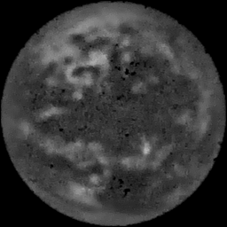

# Reconstruction rerun (Colab)

How well can the planet's image be recovered from what the formation records? This reruns my thesis's reconstruction network, a finite-basis physics-informed neural network (FBPINN), under the physical lens blur from Toth & Turyshev (2021), and compares it with classical methods on the same noisy measurements.

[`fbpinn_corrected_psf.py`](fbpinn_corrected_psf.py) is the source, and [`build_notebook.py`](build_notebook.py) turns it into the Colab notebook [`fbpinn_corrected_psf.ipynb`](fbpinn_corrected_psf.ipynb). The notebook's header says how to run it. The results are in [`fbpinn_corrected_psf_results/`](fbpinn_corrected_psf_results).

## Results

Reconstruction SNR (higher is better) for the 256² EPIC Earth from layer A. The noise is set so that exact deconvolution of the fully measured image reaches SNR 3, 10 or 30, and either every pixel of the planet's image is measured or 10% of them are. Every method's regularization strength is tuned against the true image: an upper bound, and the same advantage for all.

| Noise level, coverage | Exact deconvolution | Tikhonov | FBPINN's loss on a pixel grid | FBPINN (thesis) | Standard PINN |
|---|---|---|---|---|---|
| SNR 3, 100% | 3.0 | 7.2 | 6.5 | 4.2 | 2.3 |
| SNR 3, 10% | – | 4.1 | 4.7 | 3.8 | 2.3 |
| SNR 10, 100% | 10.0 | 13.3 | 6.5 | 4.2 | 2.3 |
| SNR 10, 10% | – | 4.3 | 4.8 | 3.7 | 2.3 |
| SNR 30, 100% | 29.8 | 27.7 | 6.5 | 4.2 | 2.3 |
| SNR 30, 10% | – | 4.3 | 4.8 | 3.8 | 2.3 |

- **The network costs accuracy.** Filtered (Tikhonov) deconvolution beats the FBPINN in every case, and so does the FBPINN's own loss optimized directly on a pixel grid. The FBPINN still beats a standard PINN.
- **The FBPINN's loss plateaus.** Fitted by the network or directly on a pixel grid, it stays flat however low the noise (about 4.2 and 6.5; the standard PINN stays at 2.3), while exact and Tikhonov deconvolution keep improving. On the grid, the best regularization weight was the smallest one tried (10⁻⁵) in every case, so a wider sweep might do better.
- **Sparse sampling levels the field.** With 10% of the image's pixels measured, every method lands between SNR 2 and 5.

| Truth | Tikhonov, SNR 10, 100% | FBPINN, SNR 10, 100% |
|---|---|---|
|  |  |  |
